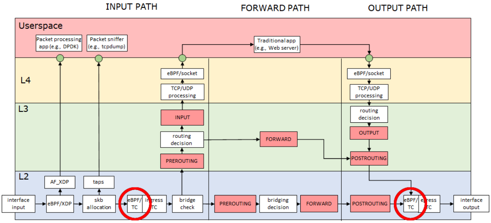

# Network Monitoring with eBPF

## 1. Introduction

This laboratory activity aims to guide the reader through the usage of the eBPF technology to analyze network traffic and grab different statistics thereof. This will be achieved by means of the `libbpf` library and the `bpftool` tool, both of which are "_official_" Linux utilities (i.e., they are co-developed within the kernel's source tree).

In this lab, you will experiment with the creation of an eBPF application to analyze all packets generated and received by a network interface of a host and print a summary of the different endpoints (i.e., IP address and port) that are contacted, along with the number of packets transmitted/received and the overall amount of traffic (in bytes) that is exchanged for each of them.

### `libbpf`

`libbpf` is a C library that facilitates handling the lifecycle of eBPF programs. It embeds an eBPF loader, that is able to parse an eBPF object (in [ELF](https://en.wikipedia.org/wiki/Executable_and_Linkable_Format) format), identify eBPF programs and maps, and inject them into the kernel. Moreover, `libbpf` provides a useful API to interact with programs, maps, and hook points, by abstracting the use of the _single_ eBPF-related system call provided by Linux, [`bpf()`](https://man7.org/linux/man-pages/man2/bpf.2.html). The documentation for `libbpf` can be found at [https://libbpf.readthedocs.io/en/latest/libbpf_overview.html](https://libbpf.readthedocs.io/en/latest/libbpf_overview.html).

### `bpftool`

`bpftool` is a command-line tool built on top of `libbpf` that can be used to interact with the eBPF subsystem from the command line. For instance, the following two commands can be used to list all the eBPF programs and maps that currently exist in the system.

```bash
sudo bpftool prog show
sudo bpftool map show
```

`bpftool` documentation is automatically installed along with the tool, and can be accessed with `man bpftool`; various online mirrors also exist. Among other things, the tool can be used to generate a _skeleton_ starting from a compiled eBPF object file (`.o`). The skeleton is a C header file that provides methods to simplify the interaction with the specific eBPF program, and represents an alternative to the generic API exposed by `libbpf`. Moreover, it embeds the whole eBPF object file as a variable, allowing to ship the eBPF application as a single, self-contained executable. More details on the eBPF skeleton abstraction can be found at [https://nakryiko.com/posts/libbpf-bootstrap/](https://nakryiko.com/posts/libbpf-bootstrap/).

The general eBPF documentation can be found at [https://docs.kernel.org/bpf/index](https://docs.kernel.org/bpf/index). In particular, helpers that can be used by eBPF programs are documented at [https://man7.org/linux/man-pages/man7/bpf-helpers.7.html](https://man7.org/linux/man-pages/man7/bpf-helpers.7.html), and map types at [https://docs.kernel.org/bpf/maps.html](https://docs.kernel.org/bpf/maps.html).

## 2. Initial eBPF application

In this lab, two equivalent starting templates are provided. Both implement the minimum subset of operations required to compile, load, and attach an eBPF/TC program using `libbpf`. The difference is in the host programming language used: C for [initial-application-c](initial-application-c), and Rust for [initial-application-rs](initial-application-rs). As a result, the latter uses a _slightly_ higher level `libbpf` API and is a personal favourite. Feel free to choose the option that best suits your programming skills and preferences. Compilation and usage information is contained in their respective folders.

The initial applications loads a program to both TC _ingress_ and _egress_, and perform some simple packet parsing and classification. Specifically, they count packets and bytes on a per-L3 protocol (i.e., IP, IPv6, ARP, etc.) fashion, periodically presenting this information to the final user. In the following sections, you will be tasked with extending this initial implementation, introducing new functionalities for more in-depth monitoring.



### eBPF _hook point_ (and _program type_) selection

As mentioned, during this laboratory we are using the eBPF/TC hook points. This is a low-level networking hook point/program type that gives eBPF programs full access to the raw bytes of each network packet crossing either the _ingress_ (packet reception), or _egress_ (packet transmission), depending on where exactly the eBPF program was attached by the user. Since we are interested in _all_ networking traffic, we decided to attach the same monitoring program to both traffic directions (note however that this is still scoped to a single network interface!).

eBPF programs can be attached to the TC hook points through a special _queueing discipline_ (_qdisc_). Qdiscs are queueing policies that can be attached to network interfaces and define how packets are scheduled for transmission and reception. You will use a _clsact_ qdisc (_Classify Action_), which allows to attach eBPF classifiers (or _filters_), to both the ingress and egress.

### Common architectural features of the starting application

A similar architecture is implemented for both C- and Rust-based initial applications. In particular, three main components exist in both versions:

- **Userspace entry point.** (`network_monitor.c` or `src/main.rs`). This defines the `main` function, and the entry point to your program. This code **always** runs entirely in userspace, and is responsible for:
  1. loading the eBPF program in the kernel.
  2. Creating the required TC qdiscs.
  3. Attaching the loaded program to TC ingress and egress on the created qdiscs.
  4. Periodically access the eBPF maps to extract packet metadata produced by the eBPF program in the kernel, and present it to the user via `stdout`.
  5. Perform the necessary clean-up on program exit.
- **eBPF code.** (`network_monitor.bpf.c` or `src/bpf/network_monitor.bpf.c`). The actual eBPF _restricted-C_ code that will be loaded and executed in kernel space. There is almost no difference between the two initial application options (both are written in C). One of them is that the Rust version uses a generic BTF-generated `vmlinux.h` as the kernel sources header file and does not require kernel sources to be installed on the development machine, whereas the C version does.
- **Common definitions.** (`network_monitor.h` or `src/bpf/network_monitor.h`). This is a C header that defines common data structures between the eBPF program in the kernel and the userspace, control-plane component. Its main use is in avoiding double definitions, though note that, although the same header can be included as-is in the C version's userspace program, it must be converted to Rust in the Rust version. This is done automatically via `bindgen` in the provided example.

Please refer to the respective version's Readme, as well as the included source code comments for additional details.

## 3. Build and run the example application

As the first "exercise" of this lab, simply get comfortable with your chosen initial application's source code, compile it following the provided instructions, and run it.

You should see something like the following:
```bash
$ sudo ./network_monitor <ifname>
Successfully started! Please run `sudo cat /sys/kernel/debug/tracing/trace_pipe` to see output of the BPF program.

Proto IPv4: 323 pkts, 29920 bytes

Proto IPv4: 3364 pkts, 366652 bytes

Proto IPv4: 4196 pkts, 457840 bytes

Proto IPv4: 4220 pkts, 459925 bytes

Proto IPv4: 4228 pkts, 460573 bytes
^C
```

**WARNING:** _the program is operating on the original network traffic (not a copy of the packets!), hence, modifying or dropping packets can result in communication problems on the monitored interface. This is especially "dangerous" if working on a remote environment (e.g., a Crownlabs VM), where connectivity to the host can be completely lost. In this case, it is suggested to first test the behavior of the program on the loopback interface (`lo`), and then run it on the main network interface._

### Dealing with the eBPF verifier

eBPF programs are executed in the kernel at a high privilege level. To guarantee the absence of programming bugs or malicious operations that would compromise the integrity of the system, the verifier analyzes each program before it is injected. In particular, to pass the verification step, the programmer has to add explicit checks that prevent any potential memory access to an invalid memory address. For instance, this is a simplified version of the code used by the application to access the `ethertype` field of the ethernet header of the packet:

```c
void *data = (void *)(unsigned long)ctx->data;
void *data_end = (void *)(unsigned long)ctx->data_end;
struct ethhdr *eth = data;

if (data + sizeof(*eth) > data_end)
    return TC_ACT_SHOT;

bpf_printk("Processed packet with l3proto 0x%04x\n", bpf_ntohs(eth->h_proto));
```

Notice that we are explicitly checking that the packet buffer is big enough to contain the ethernet header _before_ the memory access. Removing the check would result in the following verifier error upon program loading:

```
; void *data = (void *)(unsigned long)ctx->data;
0: (61) r7 = *(u32 *)(r1 +76)
; bpf_printk("Processed packet with l3proto 0x%04x\n", bpf_ntohs(eth->h_proto));
1: (71) r3 = *(u8 *)(r7 +13)
invalid access to packet, off=13 size=1, R7(id=0,off=0,r=0)
R7 offset is outside of the packet
processed 2 insns (limit 1000000) max_states_per_insn 0 total_states 0 peak_states 0 mark_read 0
```

The same principle applies to accessing map entries. The map lookup helper (`bpf_map_lookup_elem()`) returns a pointer to the map entry, and check for the validity of the pointer (`!= NULL`) is needed and enforced by the verifier before accessing its content.

## 4. Enriching the monitoring program

You are now asked to extend the provided initial application to introduce new functionalities.

Your first task is to gather information at L3/L4, modifying the sample code to extract the number of packets and byte-amount of traffic **per transport-level flow**. I.e., you should present to the user a summary similar to the following:

```
# Source IP       sport  Destination IP    dport  proto  pkt  bytes
* 172.16.38.105   19804  130.192.181.193   443    TCP    184  48705
* 130.192.181.193 443    172.16.38.105     19804  TCP    286  345860
* 172.16.38.105   35476  142.250.180.100   80     TCP    2    128
* 172.16.38.105   12098  130.192.225.102   22     TCP    12   2100
* 172.16.38.105   12098  130.192.225.102   22     TCP    14   3456
* 172.16.38.105   -      130.192.225.102   -      ICMP   2    168
* 130.192.225.102 -      172.16.38.105     -      ICMP   2    168
* 172.16.38.105   14222  8.8.8.8           53     UDP    4    1058
* 8.8.8.8         53     172.16.38.105     14222  UDP    4    3587
```

You can adopt an approach that is similar to what's already implemented. In particular, it is necessary to create the appropriate eBPF map to hold the data (in this case the key can be a struct containing the quintuple "flow-identifier"), and extend the `tc_prog` function to parse the relevant headers and update the corrent counters. Then, you should edit the userspace control program to present the obtained information to the final user.

## 5. Improve statistics table management

You are now required to improve the way the table of statistics is managed by your program.

### 5.1 Bi-directional session monitoring

In the former exercise the two directions of a session (host-to-server and server-to-host) are represented as two different entries in the statistics table. You are now required to collect these statistics in a single entry. This can be achieved in three different ways:
- In the control program, look for the two corresponding directions in the statistics table and merge their data.
- In the eBPF program, store both directions of a session in a single entry of the hash map. Be careful to use atomic operations to increase counters, since packets in different directions could be concurrently processed on different cores.
- In the eBPF program, store both the directions of a session in a single entry of a per-cpu hash map (`BPF_MAP_TYPE_PERCPU_HASH`). This removes the need to use atomic operations to increase counters, since every CPU core has its own instance of the value. These instances have to be merged in the control program.

### 5.2 Purging old entries

For each session, keep track of the last time a packet was detected and remove sessions from the table when they have not been active for 60 seconds. This can be achieved using the `bpf_ktime_get_ns()` helper.

## 6. (Optional) Port the program to XDP

Both XDP and TC eBPF program types operate on raw packets, and for the most part they share capabilities and features. In this final exercise, your objective is to port the program so far to XDP.

- What feature of this network monitoring application is absent under XDP and **must** be given up?
