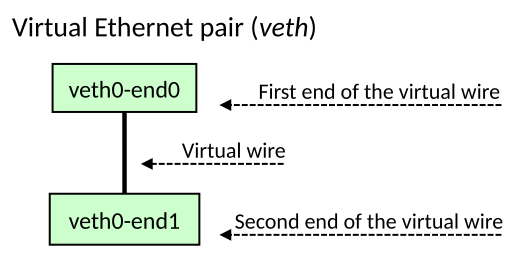
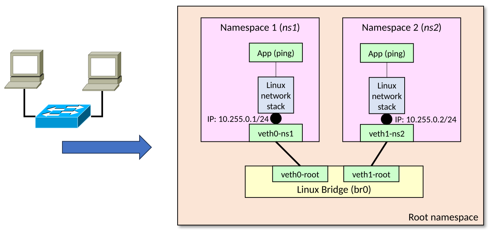
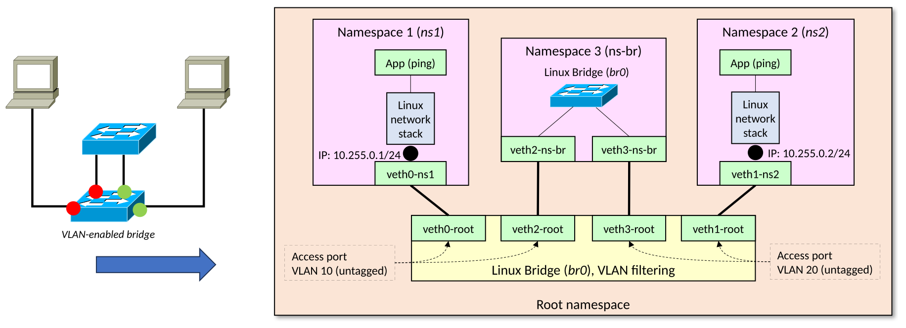
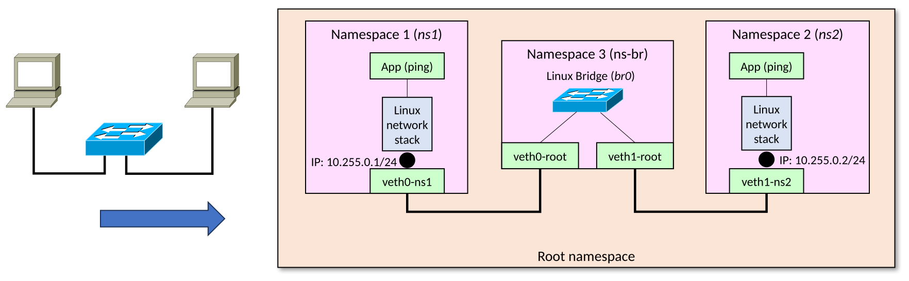
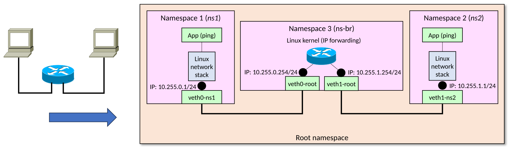
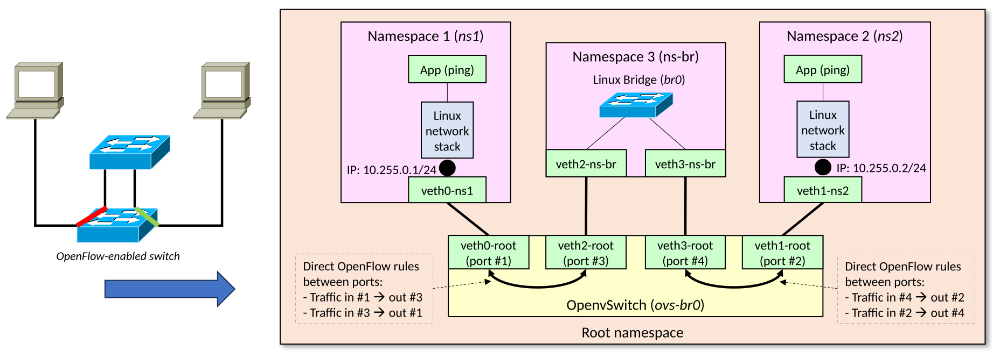
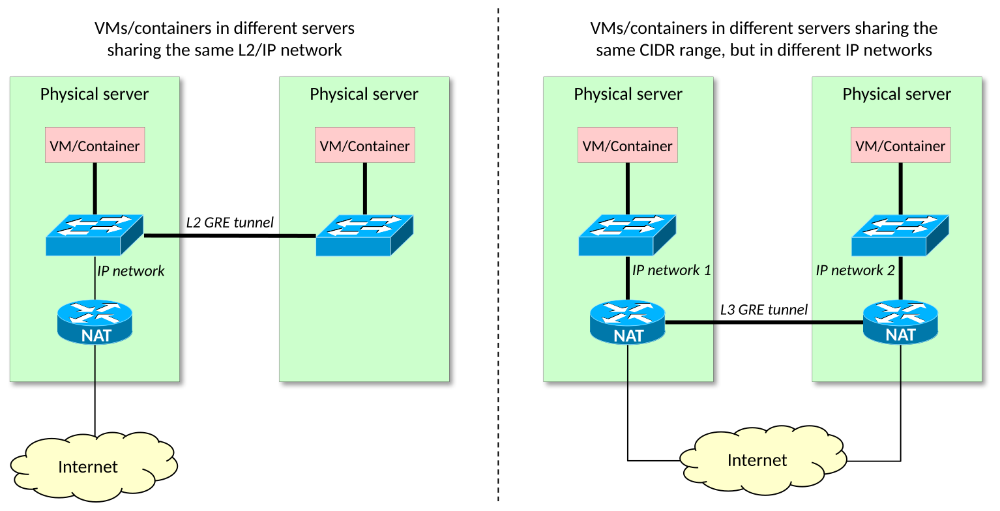
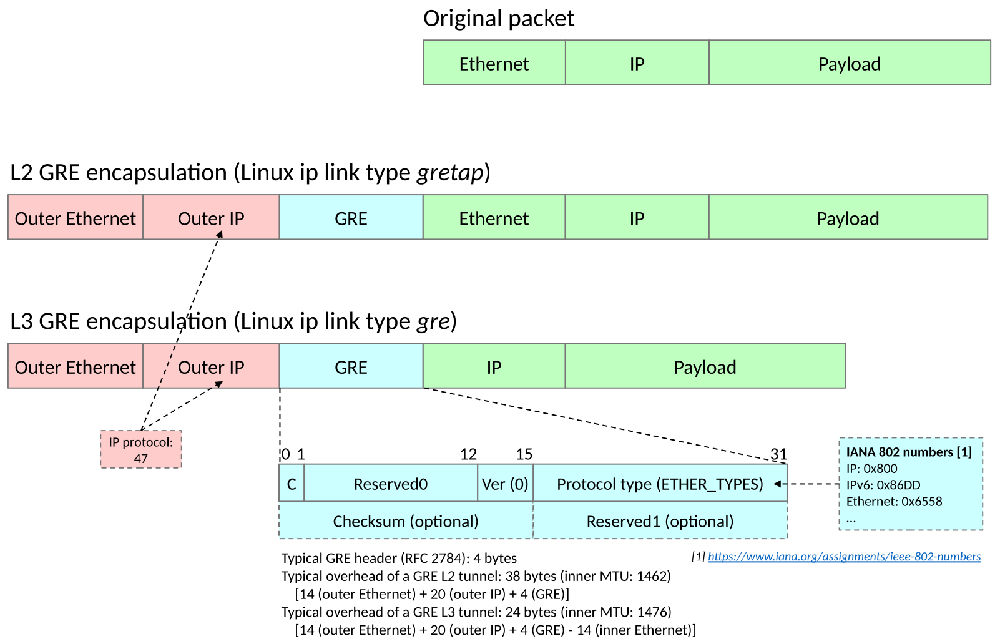
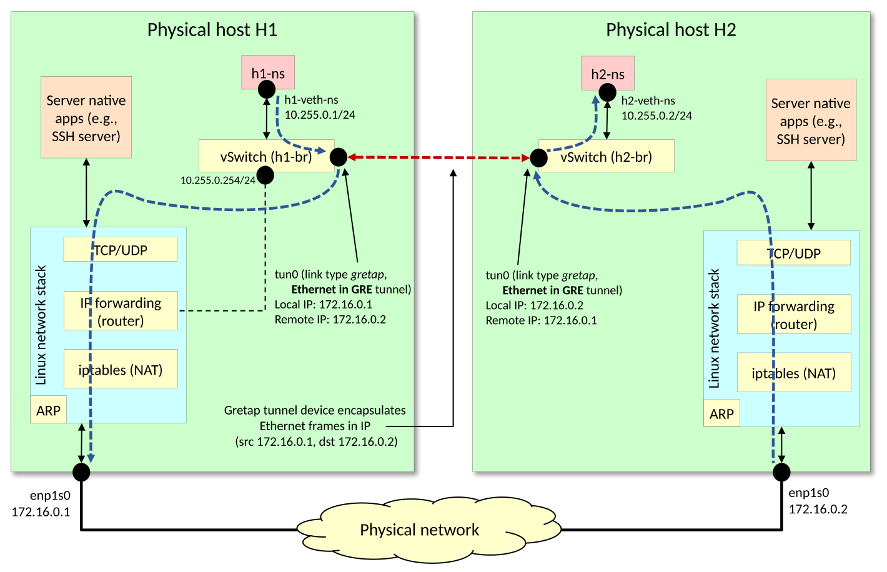
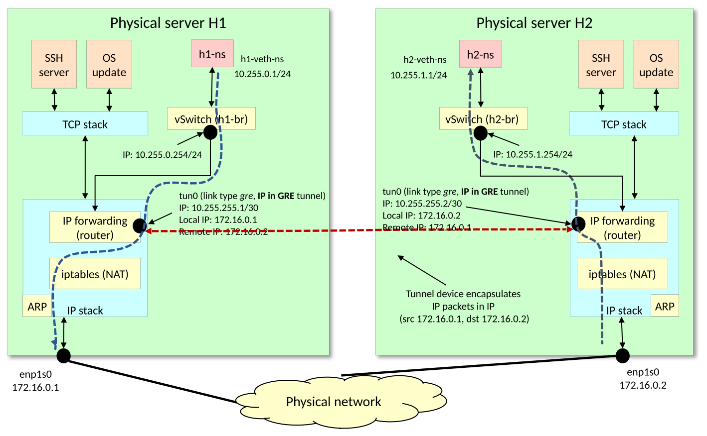

# Virtual Networking: Namespaces, Virtual Switches and Tunnels


## 1. Introduction

This lab guides the reader through the main **virtual networking** concepts, including **network namespaces**, **software switches**, and **tunnels**. These elements constitute the basic building blocks necessary to create complex virtual networks within Linux hosts, e.g., to provide network connectivity between Docker containers, as in the Kubernetes scenario.

The laboratory is organized as follows.
First, [Section 2](#2-background) provides some background information about the concepts leveraged throughout this laboratory: namespaces, virtual Ethernet links and software switches.
In [Section 3](#3-connecting-two-linux-namespaces), you will start playing with these components, partitioning the network stack of a host in different logical (but completely independent) portions by means of network namespaces, and allowing them to communicate through a software switch.
Then, [Section 4](#4-connecting-two-linux-namespaces-through-a-third-namespace) explores some more complex scenarios, characterized by a third network namespace that interconnects the other two.
Finally, [Section 5](#5-connecting-two-linux-namespaces-on-different-hosts-with-gre-tunnels) focuses on the interconnection of network namespaces located on two different hosts, through the creation of an overlay network by means of `GRE` tunnels.
The optional [Section 6](#6-optional-from-network-namespaces-to-containers) shows that Docker containers are connected to the network with exactly the same building blocks.

All the commands are meant to be executed on a Linux host (e.g., a CrownLabs virtual machine) with administrative privileges.
For each section, the `snippets` folder contains a script that builds the whole configuration at once.

Notes:

- Sections marked **Optional** use Open vSwitch or present additional technologies; they can be skipped without affecting the rest of the laboratory.
- Sections 2-4 can be completed using a single machine (e.g., the *Software Networking* VM on CrownLabs), while Section 5 requires two machines (e.g., two *Software Networking* VMs running in parallel).


## 2. Background

### 2.1 Linux namespaces

*Linux namespaces are a feature of the Linux kernel that partitions kernel resources such that one set of processes sees one set of resources while another set of processes sees a different set of resources* ([Wikipedia](https://en.wikipedia.org/wiki/Linux_namespaces)).
In other words, they enable the creation of distinct virtual environments with respect to a given type of kernel resource, so that different namespaces have a completely independent view of it.
For instance, two `network` namespaces are associated with independent networking stacks, virtual interfaces, IP addresses, routing tables and so on.

As of today, the Linux kernel provides eight types of namespaces, which constitute one of the building blocks of lightweight virtualization (e.g., Docker containers).
The isolation provided by Linux namespaces is weaker than the isolation obtained with virtual machines, as the underlying kernel is shared; on the other hand, the overhead is also lower, since no hardware virtualization is involved.
Each namespace type deals with different resources: networking, mount points, process IDs, IPC, and so on. In the following, we will specifically play with `Network (NET)` namespaces.

#### Network namespaces

A `NET` namespace allows two processes to perceive a completely different and independent network setup.
In other words, each `NET` namespace is characterized by its own set of IP addresses, its own routing table, firewall rules, and so on. Even the loopback interface is different.
Whenever a new network namespace is created, it contains only a loopback interface.
Afterwards, you can attach either physical or virtual interfaces to the newly created namespace (each network interface is present in exactly one namespace).

### 2.2 Virtual Ethernet links

A *virtual Ethernet link* (`veth`) is a pair of virtual network interfaces connected to each other, which behaves like an Ethernet cable with a network card at each end ([Figure 2.1](#figure-2-1)): every frame sent into one end is immediately received on the other end, and vice versa.

Analyzing the behavior of the Linux network stack, a packet exiting from a network namespace is delivered to the output NIC `veth` driver, which accepts the packet and confirms that the data has been sent out correctly.
Immediately after, this software module (this time, acting as input NIC `veth` driver, which corresponds to the other end of the virtual wire) tells Linux that a new packet has arrived and needs to be delivered to the operating system. This can be achieved with one of the available notification mechanisms, such as raising a software interrupt (softirq), hence bringing again the packet into the Linux network stack for the next steps.

The two ends are created (and deleted) together, and each of them is a regular network interface: it has its own MAC address, it can be assigned an IP address, and it can be attached to a software switch.

<a name="figure-2-1"></a>
<p align="center"></p>
<p align="center"><em>Figure 2.1: A virtual Ethernet pair (<code>veth</code>).</em></p>

The key property of a `veth` pair is that its two ends can be placed in **different network namespaces**. Hence, `veth` pairs are the standard way to connect a network namespace to the outside world: one end is moved into the namespace, while the other end remains in the root namespace (or in another namespace), where it is typically attached to a software switch.
This is exactly how Docker containers and Kubernetes pods are connected to the network of their host.

```bash
# Create a veth pair, whose ends are called 'veth0-end0' and 'veth0-end1'
sudo ip link add veth0-end0 type veth peer name veth0-end1

# Show the two ends ('@' indicates the peer interface)
ip link show type veth

# Deleting one end automatically deletes the whole pair
sudo ip link del veth0-end0
```

### 2.3 Software switches

A *software switch* implements switching functions, either traditional layer 2 forwarding or OpenFlow-based, within a Linux environment.
It connects different entities (e.g., network namespaces or virtual machines) through a virtual network operating at the data-link layer, hence behaving like a traditional Ethernet switch.

Just like its physical counterpart, a virtual switch does more than just forward data packets: it also implements the *backward learning* algorithm, *VLANs*, the *Spanning Tree Protocol*, and so on.
Optionally, software switches may also support the configuration through *OpenFlow* rules.

Two well-known software switches are the *Linux Bridge* and *Open vSwitch (OvS)*. The former is part of every standard Linux installation, and it excels in terms of simplicity and reliability: **it is the switch used in the main parts of this laboratory**. Open vSwitch is an open-source project that provides more advanced features, including the support for OpenFlow and for more tunneling protocols; it is used only in the optional parts.

#### 2.3.1 The Linux Bridge

A Linux Bridge is created, configured and deleted with the same `ip link` command used for any other network interface; the `bridge` command shows (and modifies) its bridging-specific state:

```bash
# Create a Linux Bridge called 'br0' and set it 'up'
sudo ip link add br0 type bridge
sudo ip link set dev br0 up

# Attach an interface (e.g., 'veth0-root') to the bridge, i.e., make it a bridge port
#   h1-br is now its "master" device, meaning tun0 is now controlled by the bridge
sudo ip link set dev veth0-root master br0

# Show the bridge ports, the filtering database (learned MAC addresses) and the VLANs
bridge link show
bridge fdb show br br0
bridge vlan show

# Delete the bridge
sudo ip link del br0
```

The Spanning Tree Protocol is disabled by default on the Linux Bridge; remember this aspect if you build a bridged topology that contains loops.

When an interface is attached to a bridge (the *master* command), all frames that arrive on that interface are no longer delivered to the host IP stack.
They go to the bridge, which forwards them by MAC address like a switch.
Furthermore, the interface is switched to promiscuous mode, so it receives frames addressed to any MAC address, not just its own, as a switch port must.

Finally, it follows the bridge's settings: it takes part in the bridge's MAC learning, VLAN filtering (Section 4.1.1) and STP state; the bridge's MTU is limited by the smallest MTU among its ports.

#### 2.3.2 Optional: Open vSwitch (OvS)

Open vSwitch is a multilayer software switch, which implements a production-quality switching platform supporting standard management interfaces and opening the forwarding functions to programmatic extension and control.
It is well suited to function as a virtual switch in virtualized environments and was designed to support traffic distribution across multiple physical servers.
Open vSwitch can act as a traditional 802.1d bridge or as an OpenFlow switch; mixed-mode operations are supported as well.
The default configuration of OvS is to work in bridging mode, with the Spanning Tree Protocol disabled.

If OvS is not installed, it can be installed with `sudo apt install openvswitch-switch`.

##### OvS configuration

The configuration of OvS bridges is performed through two main commands. The bridging logic (e.g., create/delete a bridge, add/remove a port, show the status of the bridge) is controlled through the `ovs-vsctl` command, while OpenFlow rules are managed with the `ovs-ofctl` command.

The configuration of OvS is stored in a local database (OVSDB); an OvS daemon reads the new configuration and applies it to the selected bridge.
This explains why several commands look like simplified SQL statements, which set a value in a table.
For instance, the command that sets a VLAN ID on a port is the following, where *port* is one of the tables defined in the Open vSwitch database schema:

```bash
# Set the port 'vnet0' as access port, and mark it with VLAN 100
sudo ovs-vsctl set port vnet0 tag=100
```

This value can be reverted with the `remove` command, which has a slightly different syntax:

```bash
# Remove the VLAN ID from port 'vnet0'
# This time we no longer use 'tag=100', but 'tag 100'
sudo ovs-vsctl remove port vnet0 tag 100
```

##### Restoring the default OvS configuration

As OvS stores its configuration in a local database, the configuration is preserved even if we reboot the machine.
Therefore, we have to clean up the OvS database manually in order to remove its configuration:

```bash
# Clear most of the configuration contained in the ovsdb database
sudo ovs-vsctl emer-reset

# The previous command does not delete the bridges we have created.
# Assuming we created a bridge called 'ovs-br0', we can delete it with the
#   command below. Please note that this command also clears
#   all the IP configuration possibly associated to that bridge.
sudo ovs-vsctl del-br ovs-br0
```

## 3. Connecting two Linux namespaces

The goal of this section is to create two network namespaces, and interconnect them through a software switch, hosted by the root (i.e., the default) network namespace.

This scenario simulates the case in which different processes (e.g., two web servers) are running in the same host, but they must be isolated in completely independent network spaces.
In this case, each process binds to its own network address, resulting in a new, independent TCP/IP stack for each of the two namespaces.

Similarly to the physical world, in which different hosts need to be connected to a switch in order to exchange traffic, here we need a (software) switch to allow the communication between the two entities.
We will use a Linux Bridge; the optional [Section 3.5](#35-optional-replacing-the-linux-bridge-with-open-vswitch) shows how to obtain the same result with Open vSwitch.

The topology that we are going to create is depicted in [Figure 3.1](#figure-3-1): two namespaces called `ns1` and `ns2` are connected through a software switch.
The connection towards the virtual switch is implemented by means of virtual Ethernet pairs (`veth`).

<a name="figure-3-1"></a>
<p align="center"></p>
<p align="center"><em>Figure 3.1: Two namespaces connected through a virtual switch in the root namespace.</em></p>

### 3.1 Building the topology: network namespaces

In this part, we start building the topology depicted in [Figure 3.1](#figure-3-1). In particular, we create the two network namespaces and the `veth` pairs, and we configure the relevant IP addresses.

To begin, let's create our first namespace named `ns1`:

```bash
# Create a new network namespace called 'ns1'
sudo ip netns add ns1
```

The **list** of available `NET` namespaces is visible by typing `ip netns list` (or the shorter version `ip netns`).
A **command** (e.g., running an application) can be issued in the newly created namespace with `ip netns exec <namespace_name> <command>`.

For instance, let's show the network interfaces available within `ns1`:

```bash
sudo ip netns exec ns1 ip link
```

Currently, you should only see the `lo` (loopback) interface, with associated state `DOWN`.

Let's enable it and verify it works with a ping to `localhost` (of the namespace):

```bash
# Move the state of device loopback ('dev lo') to up
sudo ip netns exec ns1 ip link set dev lo up
sudo ip netns exec ns1 ping 127.0.0.1
```

> [!NOTE]
> If the loopback device is *down*, you can ping neither the loopback address nor any other address configured in the namespace (e.g., the address `10.255.0.1` that will be configured in the following), as all local traffic is delivered through the loopback device.

Now, we need to connect the `ns1` namespace to the "root namespace".
To this end, we create a Virtual Ethernet device (`veth`, see [Section 2.2](#22-virtual-ethernet-links)): a pair of virtual interfaces that behave like the two ends of a cable, possibly placed in different namespaces.
Whatever is sent into one end comes out of the other end, allowing the traffic to cross the namespace border.

To proceed, let's create the new `veth` pair and push one end into the desired namespace:

```bash
# Create the first virtual Ethernet link (i.e., 'veth' pair); the two
#   ends are virtual interfaces called 'veth0-root' and 'veth0-ns1'
# Right now, both ends are in the 'root' namespace
sudo ip link add veth0-root type veth peer name veth0-ns1

# Move one side of the veth pair ('veth0-ns1') into the namespace 'ns1'
sudo ip link set veth0-ns1 netns ns1
```

The `ip link add` command creates a new link of type `veth`, with both ends in the root namespace; the second command moves the `veth0-ns1` end into the `ns1` namespace.

**Alternatively**, this shorter command does everything in just one step:

```bash
sudo ip link add veth0-root type veth peer name veth0-ns1 netns ns1
```

Once the `veth` is in place, we can assign the IP address to the end in the network namespace.
Conversely, we do not need to assign an IP address to the other end of the `veth` pair, as it will be attached to the software switch in [Section 3.2](#32-building-the-topology-the-linux-bridge), and interfaces attached to a bridge do not have any IP address.
For the moment, we just have to set its state to `UP`:

```bash
# Set both ends of the veth 'up'
sudo ip link set dev veth0-root up
sudo ip netns exec ns1 ip link set veth0-ns1 up

# Assign an IP address to the device veth0-ns1 (ns1 namespace)
sudo ip netns exec ns1 ip addr add 10.255.0.1/24 dev veth0-ns1
```

Now, you can see that the new address answers if *pinged* from the `ns1` namespace, while it is unknown if *pinged* from the root namespace:

```bash
# Ping from the root namespace: we expect no answers
ping 10.255.0.1

# Ping from the ns1 namespace: we expect answers to our requests
sudo ip netns exec ns1 ping 10.255.0.1
```

Now, repeat the previous steps to **reproduce the second part of the topology** depicted in [Figure 3.1](#figure-3-1).
In other words, you are required to create the second namespace (`ns2`) and a new `veth` pair (`veth1-root` / `veth1-ns2`), and to configure the IP address `10.255.0.2/24`.

### 3.2 Building the topology: the Linux Bridge

You should now have the two network namespaces correctly configured. However, it is still not possible to ping one namespace from the other, as the virtual switch has not yet been created and configured.

Now, let's proceed creating a Linux Bridge to interconnect the two namespaces:

```bash
# Create a new Linux Bridge called 'br0'
sudo ip link add br0 type bridge

# Set the bridge status to 'up'
sudo ip link set dev br0 up
```

Once the virtual switch is `UP`, you can connect the "root-namespace" end of each `veth` pair to the bridge itself (remember that in the previous section we pushed the other end of each `veth` pair into the corresponding network namespace):

```bash
# Attach the 'root' side of each veth pair to the bridge
sudo ip link set dev veth0-root master br0
sudo ip link set dev veth1-root master br0
```

Finally, you can verify that the two namespaces can communicate with each other. In other words, the `ping` should now work as expected:

```bash
sudo ip netns exec ns1 ping 10.255.0.2
# PING 10.255.0.2 (10.255.0.2) 56(84) bytes of data.
# 64 bytes from 10.255.0.2: icmp_seq=1 ttl=64 time=0.055 ms
# 64 bytes from 10.255.0.2: icmp_seq=2 ttl=64 time=0.043 ms
```

You can also look at the MAC addresses learned by the bridge with `bridge fdb show br br0`.

### 3.3 Cleaning up the lab

If you want to reset the environment and restart from scratch, you can delete the different components we created up to now. However, it is better not to delete them now, as we will reuse and extend this topology in [Section 4](#4-connecting-two-linux-namespaces-through-a-third-namespace).

```bash
# Delete all the veth pairs
sudo ip link del veth0-root
sudo ip link del veth1-root

# Delete all the namespaces
sudo ip netns del ns1
sudo ip netns del ns2

# Delete the virtual switch
sudo ip link del br0
```

### 3.4 Full configuration

In case something still does not work properly, as a last resort you can use the [`snippets/3-two-namespaces-switch-root.sh`](snippets/3-two-namespaces-switch-root.sh) script, which sets everything up at once (and also cleans up the environment when it terminates):

```bash
bash snippets/3-two-namespaces-switch-root.sh
```

### 3.5 Optional: replacing the Linux Bridge with Open vSwitch

In the previous sections you obtained a working configuration, with two namespaces interconnected through a Linux Bridge. Now, we can replace this component with an Open vSwitch bridge, and see that the two are functionally equivalent.

First, let's delete the Linux Bridge:

```bash
# Delete the 'br0' bridge
sudo ip link del br0

# The ping should no longer work
sudo ip netns exec ns1 ping 10.255.0.2
```

Now, we can create the OvS bridge and attach the two `veth` interfaces. Essentially, we repeat the operations of [Section 3.2](#32-building-the-topology-the-linux-bridge), but with the OvS-specific commands:

```bash
# Create a new OvS bridge called 'ovs-br0'
sudo ovs-vsctl add-br ovs-br0

# Attach the 'root' side of each veth pair to the bridge
sudo ovs-vsctl add-port ovs-br0 veth0-root
sudo ovs-vsctl add-port ovs-br0 veth1-root
```

You can now verify that it is again possible to ping one namespace from the other. Additionally, you can print the configuration of OvS with `sudo ovs-vsctl show`, which should return an output similar to the following:

```
f2e911dc-245c-4429-91cc-f8ca840e74e1
    Bridge ovs-br0
        Port veth0-root
            Interface veth0-root
        Port ovs-br0
            Interface ovs-br0
                type: internal
        Port veth1-root
            Interface veth1-root
    ovs_version: "2.13.1"
```

The script [`snippets/3-optional-openvswitch.sh`](snippets/3-optional-openvswitch.sh) builds this configuration at once.

> [!IMPORTANT]
> Before moving to Section 4, go back to the Linux Bridge: delete the OvS bridge (`sudo ovs-vsctl del-br ovs-br0`) and recreate `br0` as described in [Section 3.2](#32-building-the-topology-the-linux-bridge).


## 4. Connecting two Linux namespaces through a third namespace

In the second part of this laboratory, we connect two network namespaces through an intermediate Linux Bridge running in a third network namespace. The first topology to be reproduced is depicted in [Figure 4.1](#figure-4-1). Then, we explore different variations of this scenario, modifying how the three namespaces are interconnected.

<a name="figure-4-1"></a>
<p align="center"></p>
<p align="center"><em>Figure 4.1: Two namespaces connected through a virtual switch in a third namespace (VLAN).</em></p>

We start from the configuration of [Section 3](#3-connecting-two-linux-namespaces), i.e., the two namespaces `ns1` and `ns2` connected to the Linux Bridge `br0` in the root namespace.
Now, the bridge ports are configured as VLAN *access ports*: the one towards `ns1` belongs to VLAN 10, the one towards `ns2` to VLAN 20.
Since the two namespaces are connected to different VLANs, they can no longer reach each other through the root bridge. For this reason, we create a second Linux Bridge in a third namespace, and connect it to both VLANs of the root bridge, in order to provide the desired connectivity.

> [!NOTE]
> [Figure 4.1](#figure-4-1) contains two bridges named `br0`: one in the root namespace and one in `ns-br`. This is allowed, because each network namespace has its own independent set of interface names.

If your configuration of Section 3 is no longer available, please refer to [Section 3](#3-connecting-two-linux-namespaces) to reproduce it (e.g., with the script of [Section 3.4](#34-full-configuration), stopping it before it cleans up the environment).
In [Section 4.1](#41-building-the-initial-topology) we build the remaining part of the topology of [Figure 4.1](#figure-4-1), configuring the VLANs as well as the third namespace.
Then, [Section 4.2](#42-replacing-the-root-bridge-with-direct-connections) proposes a different approach, implementing a direct connection to the third namespace through `veth` pairs (i.e., without the bridge in the root namespace), and [Section 4.3](#43-replacing-the-bridge-with-a-router) replaces the bridge with a router, as the IP addresses of the two namespaces will belong to different networks.
Finally, the optional [Section 4.6](#46-optional-the-same-topology-with-open-vswitch-vlans-and-openflow-rules) builds the topology of [Figure 4.1](#figure-4-1) with Open vSwitch, and then replaces the VLAN configuration with OpenFlow rules.

### 4.1 Building the initial topology

In this part we implement the topology depicted in [Figure 4.1](#figure-4-1), and then verify that the connection between the two namespaces is correctly established (e.g., using the `ping` command).

#### 4.1.1 Configuring the VLANs on the Linux Bridge

By default, a Linux Bridge ignores VLANs. VLAN support (called *VLAN filtering*) must be enabled explicitly:

```bash
# Enable VLAN filtering on the existing Linux Bridge
sudo ip link set dev br0 type bridge vlan_filtering 1

# Show the VLAN configuration of the bridge ports
bridge vlan show
```

The output shows that every port is an untagged member of VLAN 1, which is also its *PVID* (Port VLAN ID, i.e., the VLAN assigned to untagged frames received on that port). In other words, by default all the ports belong to the same VLAN, exactly as in a physical switch.

We now configure port `veth0-root` as an access port in VLAN 10 and port `veth1-root` as an access port in VLAN 20.
Instead, the interfaces `veth0-ns1` and `veth1-ns2`, which are inside the two network namespaces, do not know anything about VLANs: they behave like plain Ethernet cables connected to traditional hosts.

```bash
# veth0-root: remove the default VLAN 1, then make it an access port in VLAN 10
#   'pvid': untagged frames received on this port belong to VLAN 10
#   'untagged': frames of VLAN 10 leave this port without the VLAN tag
sudo bridge vlan del dev veth0-root vid 1
sudo bridge vlan add dev veth0-root vid 10 pvid untagged

# veth1-root: same, with VLAN 20
sudo bridge vlan del dev veth1-root vid 1
sudo bridge vlan add dev veth1-root vid 20 pvid untagged
```

At this point, the VLAN configuration (`bridge vlan show`) should look similar to the one below, and it should no longer be possible to ping one namespace from the other.

```
port              vlan-id
veth0-root        10 PVID Egress Untagged
veth1-root        20 PVID Egress Untagged
br0               1 PVID Egress Untagged
```

The last line refers to the bridge device itself (i.e., the bridge as seen by the TCP/IP stack of the root namespace), which is not used in this exercise.

#### 4.1.2 Creating the bridge in a third network namespace

Now, you can build the remaining part of the topology. Specifically, it is necessary to:

- create a new network namespace (`ns-br`), which will host the second Linux Bridge;
- create the `br0` Linux Bridge inside the `ns-br` namespace;
- create two `veth` pairs (`veth2-root` / `veth2-ns-br` and `veth3-root` / `veth3-ns-br`), with one end in the root namespace and the other in the `ns-br` namespace;
- attach the "root-namespace" end of each `veth` pair to the root bridge, configuring it as access port of the proper VLAN (`veth2-root` in VLAN 10, `veth3-root` in VLAN 20);
- attach the other end of each `veth` pair to the `br0` Linux Bridge in `ns-br`.

You should be able to complete the configuration by adapting the commands used in the previous sections.
Then, verify that `ns1` can now reach `ns2` and vice versa, by sending a `ping` in both directions.
In case something does not work, use `tcpdump` or `wireshark` to identify where the packets are lost (when capturing inside a network namespace, you may need the `-l` flag of `tcpdump` to print each packet as soon as it is captured, instead of only at the end of the capture).

> [!NOTE]
> All devices created with `ip link` commands (e.g., `veth` pairs, bridges, …) are `DOWN` by default, and need to be manually set to the `UP` status to work correctly.

> [!WARNING]
> Configure the VLAN on **all** the ports of the root bridge. If `veth2-root` and `veth3-root` are left in the default VLAN 1, the two bridges form a loop and you may create a broadcast storm, as the Spanning Tree Protocol is disabled by default on software bridges.

### 4.2 Replacing the root bridge with direct connections

In this section, we modify again the topology, directly interconnecting the three namespaces (i.e., removing the bridge in the root namespace), as depicted in [Figure 4.2](#figure-4-2).
Overall, this configuration looks simpler than the previous one, since it does not require a virtual switch in the root namespace.

<a name="figure-4-2"></a>
<p align="center"></p>
<p align="center"><em>Figure 4.2: Two namespaces connected through a virtual switch in a third namespace (direct connections).</em></p>

To implement the direct interconnection, we first get rid of the root bridge, as well as of the `veth` pairs connected to the `ns-br` namespace:

```bash
# Remove the Linux Bridge in the root namespace
# (the 'br0' bridge in 'ns-br' is not affected, as it lives in another namespace)
sudo ip link del br0

# Remove the veth pairs in excess (this deletes both ends of each pair)
sudo ip link del veth2-root
sudo ip link del veth3-root
```

Then, we *push* the root end of the two remaining `veth` pairs into the `ns-br` namespace, and attach them to its Linux Bridge:

```bash
# 'Push' the veth ends into the ns-br namespace
sudo ip link set veth0-root netns ns-br
sudo ip link set veth1-root netns ns-br

# Set the interfaces 'up' (moving an interface to another namespace sets it down)
sudo ip netns exec ns-br ip link set veth0-root up
sudo ip netns exec ns-br ip link set veth1-root up

# Connect the veth ends to the Linux Bridge
sudo ip netns exec ns-br ip link set dev veth0-root master br0
sudo ip netns exec ns-br ip link set dev veth1-root master br0
```

> [!NOTE]
> An interface keeps its name when it is moved to another namespace. Hence, from now on the interfaces called `veth0-root` and `veth1-root` are no longer in the root namespace, but in `ns-br` (see [Figure 4.2](#figure-4-2)).

Once those operations are completed, the connectivity between `ns1` and `ns2` should be in place again. As usual, it can be tested with a `ping`.

### 4.3 Replacing the bridge with a router

In the topologies considered up to now, the interfaces of the two *edge* namespaces belonged to the same IP network. Hence, the third namespace needed only to provide L2 connectivity, by means of a virtual switch.

We now consider a different scenario, with the two namespaces in different IP networks ([Figure 4.3](#figure-4-3)). Thus, the third namespace has to operate at L3, i.e., it has to route packets.
Routing is performed by the IP forwarding function of the Linux kernel, which forwards packets according to the routing table of the namespace: no additional routing process is needed (a routing process, such as a routing protocol daemon, would only be needed to compute the routing table automatically).

<a name="figure-4-3"></a>
<p align="center"></p>
<p align="center"><em>Figure 4.3: Two namespaces connected through a router in a third namespace.</em></p>

To reproduce the desired topology, we start by changing the address of `ns2`, to make it belong to a different IP network:

```bash
sudo ip netns exec ns2 ip addr flush dev veth1-ns2
sudo ip netns exec ns2 ip addr add 10.255.1.1/24 dev veth1-ns2
```

Then, we move to the `ns-br` namespace, delete the Linux Bridge and configure the IP addresses of the `veth` interfaces. These addresses belong to the *router* interfaces, and will be the default gateways of the *edge* namespaces:

```bash
# Delete the Linux Bridge
sudo ip netns exec ns-br ip link del br0

# Configure the IP addresses of the 'router' interfaces
sudo ip netns exec ns-br ip addr add 10.255.0.254/24 dev veth0-root
sudo ip netns exec ns-br ip addr add 10.255.1.254/24 dev veth1-root
```

Differently from the previous configurations, which required the explicit creation of a virtual switch, we did not create any *virtual router* object: the routing table of `ns-br` (each network namespace has its own independent routing table) already contains the two networks, as they are directly connected.
However, IP forwarding is disabled by default, and must be enabled in the `ns-br` namespace:

```bash
sudo ip netns exec ns-br sysctl net.ipv4.ip_forward=1
```

The configuration looks almost complete.
However, when trying to ping one namespace from the other, we discover that they are not yet reachable:

```bash
sudo ip netns exec ns1 ping 10.255.1.1
```

**Suggestion**: the problem is related to the routing tables of the edge namespaces, which do not have any route towards the remote network.
Play with the `ip route` command, which has the following syntax, and verify that the network topology now works as expected:

```bash
sudo ip route add {NETWORK/MASK} via {GATEWAY_IP}
# (example)
sudo ip route add 10.10.10.0/24 via 10.10.10.254
```

> [!TIP]
> Remember to prepend `sudo ip netns exec <namespace>` whenever you want to execute a command in a namespace.

<details>
<summary>Solution (click to expand)</summary>

```bash
sudo ip netns exec ns1 ip route add 10.255.1.0/24 via 10.255.0.254
sudo ip netns exec ns2 ip route add 10.255.0.0/24 via 10.255.1.254
```

</details>

Now, the `ping` should work as expected (note the TTL, decremented by the router):

```bash
sudo ip netns exec ns1 ping 10.255.1.1
# PING 10.255.1.1 (10.255.1.1) 56(84) bytes of data.
# 64 bytes from 10.255.1.1: icmp_seq=1 ttl=63 time=0.038 ms
# 64 bytes from 10.255.1.1: icmp_seq=2 ttl=63 time=0.069 ms
```

### 4.4 Cleaning up the lab

Before moving on to the next part of the laboratory, reset the environment by deleting the namespaces created up to now (the interfaces they contain are deleted with them):

```bash
sudo ip netns del ns1
sudo ip netns del ns2
sudo ip netns del ns-br
```

### 4.5 Full configuration

In case something still does not work properly, as a last resort you can use the [`snippets/4-two-namespaces-switch-third-ns.sh`](snippets/4-two-namespaces-switch-third-ns.sh) script, which builds the three topologies of this section one after the other (and also cleans up the environment when it terminates).

### 4.6 Optional: the same topology with Open vSwitch, VLANs and OpenFlow rules

This optional section builds the topology of [Figure 4.1](#figure-4-1) with an Open vSwitch bridge (`ovs-br0`) in the root namespace, instead of the Linux Bridge, and then replaces the VLAN configuration with OpenFlow rules ([Figure 4.4](#figure-4-4)).

<a name="figure-4-4"></a>
<p align="center"></p>
<p align="center"><em>Figure 4.4: Two namespaces connected through a virtual switch in a third namespace (OpenFlow).</em></p>

#### 4.6.1 VLANs with Open vSwitch

Start from a clean environment and recreate the namespaces `ns1`, `ns2` and `ns-br`, the `veth` pairs and the Linux Bridge `br0` in `ns-br` as in [Section 4.1](#41-building-the-initial-topology), but **without** the Linux Bridge in the root namespace.
Then, attach the four root ends of the `veth` pairs to an OvS bridge, configured with the same VLANs:

```bash
# Create the OvS bridge and attach the four ports
sudo ovs-vsctl add-br ovs-br0
sudo ovs-vsctl add-port ovs-br0 veth0-root
sudo ovs-vsctl add-port ovs-br0 veth1-root
sudo ovs-vsctl add-port ovs-br0 veth2-root
sudo ovs-vsctl add-port ovs-br0 veth3-root

# Configure the access ports (VLAN 10 towards ns1, VLAN 20 towards ns2)
sudo ovs-vsctl set Port veth0-root tag=10
sudo ovs-vsctl set Port veth2-root tag=10
sudo ovs-vsctl set Port veth1-root tag=20
sudo ovs-vsctl set Port veth3-root tag=20
```

Compare these commands with the Linux Bridge ones in [Section 4.1.1](#411-configuring-the-vlans-on-the-linux-bridge): in OvS, a port without any tag is a *trunk* port carrying all VLANs, while setting a tag makes it an access port.
The configuration (`sudo ovs-vsctl show`) should look similar to the one below, and the ping between `ns1` and `ns2` should work, through `ns-br`.

```
f2e911dc-245c-4429-91cc-f8ca840e74e1
    Bridge ovs-br0
        Port veth1-root
            tag: 20
            Interface veth1-root
        Port veth0-root
            tag: 10
            Interface veth0-root
        Port veth2-root
            tag: 10
            Interface veth2-root
        Port veth3-root
            tag: 20
            Interface veth3-root
        Port ovs-br0
            Interface ovs-br0
                type: internal
    ovs_version: "2.13.1"
```

#### 4.6.2 Replacing the VLANs with OpenFlow rules

We now leverage the capability of OvS bridges to be configured through OpenFlow rules. Once the *normal* flow (i.e., the one implementing the classical L2 behavior in OvS) is disabled, you can install rules that directly forward the packets between each pair of ports.

First, we disable the *normal* flow, hence the OvS switch will work in pure OpenFlow mode. The `sudo ovs-ofctl dump-flows ovs-br0` command displays the flows currently *installed* in the switch. The output should look similar to the following, confirming that the *normal* flow is enabled by default:

```
cookie=0x0, duration=48.725s, table=0, n_packets=108, n_bytes=11084, priority=0 actions=NORMAL
```

Now, we delete the *normal* flow that we have just identified, which is characterized by priority 0:

```bash
sudo ovs-ofctl del-flows ovs-br0 priority=0 --strict
```

Then, we remove the VLAN tags configured previously, as they are no longer needed:

```bash
# Remove the VLAN tags
sudo ovs-vsctl remove port veth0-root tag 10
sudo ovs-vsctl remove port veth1-root tag 20
sudo ovs-vsctl remove port veth2-root tag 10
sudo ovs-vsctl remove port veth3-root tag 20
```

Finally, we configure the topology depicted in [Figure 4.4](#figure-4-4), in which:

- port `veth0-root` is directly connected (bidirectionally) to port `veth2-root`;
- port `veth1-root` is directly connected (bidirectionally) to port `veth3-root`.

```bash
# Interconnect ports 0-2
sudo ovs-ofctl add-flow ovs-br0 in_port="veth0-root",actions="veth2-root"
sudo ovs-ofctl add-flow ovs-br0 in_port="veth2-root",actions="veth0-root"

# Interconnect ports 1-3
sudo ovs-ofctl add-flow ovs-br0 in_port="veth1-root",actions="veth3-root"
sudo ovs-ofctl add-flow ovs-br0 in_port="veth3-root",actions="veth1-root"
```

Verify that the communication between the two namespaces works, issuing a `ping` as usual.
The script [`snippets/4-optional-openvswitch-openflow.sh`](snippets/4-optional-openvswitch-openflow.sh) builds the configurations of this section at once.
To clean up, delete the three namespaces as in [Section 4.4](#44-cleaning-up-the-lab), the remaining `veth` pairs (`sudo ip link del veth0-root`, …) and the OvS bridge (`sudo ovs-vsctl del-br ovs-br0`).


## 5. Connecting two Linux namespaces on different hosts with GRE tunnels

In the last part of this laboratory, we further extend the network topology by interconnecting Linux namespaces hosted on different servers with `GRE` tunnels.

<a name="figure-5-1"></a>
<p align="center"></p>
<p align="center"><em>Figure 5.1: Connecting VMs or containers running on different servers with either a shared L2 network or with two routed L3 networks.</em></p>


This scenario, represented in [Figure 5.1](#figure-5-1), mimics a datacenter with several servers, which host the environments (e.g., VMs or containers) of different tenants.

In the first case, each tenant is assigned an isolated L2 network, which is implemented by means of virtual switches connected through a `GRE` tunnel that encapsulates L2 frames. This mimics the typical behavior of IaaS frameworks (e.g., OpenStack).

In the second case, tenants do not care about their Ethernet/IP networks, hence the orchestrator adopts a simplified model in which each VM/container gets a different IP network based on the server it runs upon. However, the orchestrator has to guarantee *plain* IP connectivity between VMs/containers independently of the configuration of the actual physical network, which requires a `GRE` tunnel that encapsulates L3 packets. This mimics the typical behavior of Kubernetes.

In [Section 5.2](#52-leveraging-a-layer-2-gre-tunnel-to-interconnect-two-namespaces-on-two-different-servers) we explore the case in which two network namespaces, assigned to the same tenant, must directly communicate at L2, and must also be able to reach external destinations on the Internet.
Then, in [Section 5.3](#53-leveraging-a-layer-3-gre-tunnel-to-interconnect-two-namespaces-on-two-different-servers) we explore a different configuration, implementing L3 connectivity between the two namespaces, and in the optional [Section 5.4](#54-optional-replacing-gre-with-vxlan) we replace GRE with VXLAN, the encapsulation used by most datacenters and Kubernetes network plugins.

### 5.1 GRE tunnels

Generic Routing Encapsulation (`GRE`) is a simple tunneling protocol that can encapsulate a variety of protocols inside point-to-point links over an IP network. One of the main strengths of `GRE` is its simplicity, as it requires no connection establishment before sending data.
`GRE` does not provide any encryption of the payload; hence, in a real scenario, it may be used together with L3 encryption, such as IPsec.

Among the different supported protocols, `GRE` can encapsulate either an IP packet or an entire Ethernet frame. In Linux, the first type of tunnel interface is called `gre` (*IP in GRE*), while the second one is called `gretap` (*Ethernet in GRE*). The two frame layouts are represented in [Figure 5.2](#figure-5-2).

<a name="figure-5-2"></a>
<p align="center"></p>
<p align="center"><em>Figure 5.2: Frame layout of a <code>gretap</code> (Ethernet in GRE) vs a <code>gre</code> (IP in GRE) tunnel.</em></p>


### 5.2 Leveraging a Layer 2 GRE tunnel to interconnect two namespaces on two different servers

In this part, we have two network namespaces (`h1-ns` and `h2-ns`), belonging to the same tenant, that must directly communicate at L2, and must also be able to reach external destinations on the Internet, as depicted in [Figure 5.3](#figure-5-3).

<a name="figure-5-3"></a>
<p align="center"></p>
<p align="center"><em>Figure 5.3: Two namespaces on different hosts connected through a GRE tunnel that encapsulates L2 frames.</em></p>

If you are using CrownLabs to complete this laboratory, it is now time to start a new environment, which represents the second physical server. Otherwise, you can use a different physical host, or a VM.
The two servers do not need to be connected to the same LAN: IP connectivity between them is sufficient for most of the tunneling technologies used in datacenters.

For the sake of generality, in the following we use `NIC_HOST_1` and `NIC_HOST_2` to identify the name of the physical interface of the servers (`enp1s0` in this example), and `IP_HOST_1` and `IP_HOST_2` for the respective IP addresses (`172.16.0.1` and `172.16.0.2` in this example).

#### 5.2.1 The journey of the packets

As mentioned before, the goal of this topology is to implement isolated L2 networking between namespaces hosted on two different servers, while providing them with Internet connectivity.
This section describes the path that packets follow inside the Linux networking stack.

##### Namespace to namespace connectivity through the GRE tunnel

The first goal, i.e., L2 interconnection between the two namespaces, is fulfilled by a `gretap` tunnel. Each end of the tunnel (i.e., the `tun0` interfaces) is attached to a virtual switch, which in turn interconnects one of the network namespaces.

Every packet sent by, let's say, `h1-ns`, reaches the virtual switch (i.e., `h1-br`), which forwards it according to the content of its filtering database. If the packet is forwarded to the `tun0` interface, it goes through the following processing steps:

- the packet enters the virtual interface and is passed to the network stack of the host;
- the packet is encapsulated in the proper `GRE` envelope, whose source IP address is the address of the current host (i.e., of its physical NIC) and whose destination IP address is the address of the remote host;
- the encapsulated packet follows the normal network stack processing, hence it exits from the physical NIC and travels to the remote host.

Once the packet is received by the destination host, it is processed in a specular manner:

- the packet enters the physical NIC and is delivered to the local network stack;
- the packet is decapsulated and associated to the proper `GRE` interface;
- the packet exits from the `tun0` virtual interface and reaches the virtual switch, which forwards it to the proper destination (i.e., `h2-ns`) according to the usual bridging mechanism.

> [!NOTE]
> Although [Figure 5.3](#figure-5-3) shows the path of the packet from the tunnel as entering the Linux network stack from the top, behaving as an application, Linux has a more optimized processing, so the packet never leaves the kernel. However, for the sake of clarity, the tunneling process can be modeled such as having an application that generates new data to send, where the data is actually the original Ethernet frame generated by the namespace.
> Finally, this optimization is also visible from a minor detail: a tunnel is usually configured with an explicit source address for the outer IP header, while a typical application only generates the data to send and leaves the choice of the source IP address to the Linux network stack.

##### Namespace to Internet connectivity

The second objective is to provide connectivity between the private tenant network and the Internet. This in turn requires the configuration of a default gateway for the network namespaces: this role is played by the virtual switch hosted on H1. Indeed, a Linux Bridge also has a *special* interface, named after the bridge itself, which connects the bridge to the TCP/IP stack of the host: it can be assigned an IP address and used as default gateway.

In this scenario, the bridge on H1 is the default gateway for both namespaces: hence, all traffic from `h2-ns` directed to the Internet first reaches `h1-br` through the `GRE` tunnel, before being forwarded. On the one hand, this approach introduces additional overhead, as all the external traffic of the tenant has to go through a single server; on the other hand, it simplifies the configuration and the debugging of this example, thanks to a single exit point. An alternative would be to configure each virtual switch as the default gateway (with its own IP address) for the namespaces attached to that switch, hence reducing the amount of additional traffic.

Thanks to the default gateway configuration, packets originating from the namespaces and directed to external destinations reach the `h1-br` virtual switch. Then, they go through the following processing steps:

- each packet enters the `h1-br` interface and is passed to the Linux network stack of the host;
- the Linux stack recognizes that the packet is not directed to any of the local IP addresses, and forwards it according to the routing table (e.g., the default route);
- the packet goes through the `POSTROUTING` chain of the `nat` table of iptables, where its source address is translated (*"natted"*) into the address of the physical NIC, as the address of the namespace is private.

#### 5.2.2 Building the topology

This section presents the configuration required to replicate the topology shown in [Figure 5.3](#figure-5-3), including the namespaces, the virtual switches, the `GRE` tunnel, as well as the configuration of the hosts.

##### Preliminary configuration

The physical hosts must forward packets between their interfaces (physical or virtual), i.e., IP forwarding must be enabled in their root namespace. The following command must be issued on both H1 and H2:

```bash
sudo sysctl net.ipv4.ip_forward=1
```

Moreover, on some systems you have to change the default firewall policy of the `FORWARD` chain (i.e., for packets that are being forwarded) from `DROP` to `ACCEPT`:

```bash
sudo iptables -P FORWARD ACCEPT
```

##### Creating the namespaces and the virtual switches

As a first step, create a network namespace and a virtual switch on each host, as well as the `veth` pair that interconnects them. All the steps are similar to the ones of the previous parts of the laboratory. Specifically, the commands to be issued on H1 are the following:


```bash
# Create the network namespace and the veth pair
sudo ip netns add h1-ns
sudo ip link add h1-veth-root type veth peer name h1-veth-ns netns h1-ns

# Set the interfaces 'up' and configure the IP address
sudo ip link set dev h1-veth-root up
sudo ip netns exec h1-ns ip link set dev lo up
sudo ip netns exec h1-ns ip link set dev h1-veth-ns up
sudo ip netns exec h1-ns ip address add 10.255.0.1/24 dev h1-veth-ns

# Create the Linux Bridge and attach the veth to it
sudo ip link add h1-br type bridge
sudo ip link set dev h1-br up
sudo ip link set dev h1-veth-root master h1-br
```

> [!TIP]
> The very same operations must be performed on the second host, to build a specular configuration (address `10.255.0.2/24`). Adapt the names of the different virtual objects (e.g., `h2-ns`, `h2-br`), to prevent misunderstandings in the next steps.

#### 5.2.3 Configuring the GRE tunnel

With all the basic building blocks in place, we can configure the `GRE` tunnel. Since we want to provide L2 connectivity, we create a `gretap`, which encapsulates the entire frame (i.e., including the Ethernet header).

As usual, this operation can be performed through the `ip link` command.
Let's start from the first host H1 (remember to replace the placeholders with the correct values):

```bash
# Create the tunnel interface and set it 'up'
sudo ip link add tun0 type gretap local IP_HOST_1 remote IP_HOST_2 dev NIC_HOST_1
sudo ip link set dev tun0 up
```

You can inspect the `tun0` interface we just created with `ip -d link show dev tun0` (the `-d` flag prints additional details, including the local and remote addresses).
Moreover, when listing all interfaces, you may notice that a few additional ones have been created (`gre0`, `gretap0` and `erspan0`). These special interfaces are created by the kernel module that implements GRE; they are present in all network namespaces and cannot be removed.

Finally, we attach the `tun0` interface to the software switch:

```bash
# Attach the tunnel interface to the software switch
sudo ip link set dev tun0 master h1-br
```

The configuration of the `gretap` on the first host is now complete, and must be **replicated** on the second one (H2). Then, verify whether the interconnection works by pinging one namespace from the other:

```bash
sudo ip netns exec h1-ns ping 10.255.0.2
# PING 10.255.0.2 (10.255.0.2) 56(84) bytes of data.
# 64 bytes from 10.255.0.2: icmp_seq=1 ttl=64 time=0.976 ms
# 64 bytes from 10.255.0.2: icmp_seq=2 ttl=64 time=0.647 ms
```

As usual, in case of problems, use `tcpdump` or `wireshark` to identify where the packets are lost. These tools can also be used to observe the `GRE` tunnel at work: when capturing on the `tun0` interface you should see the original packets, while on the host interface you should see the encapsulated frames.

> [!TIP]
> When capturing on the host interface in CrownLabs, filter out the packets of the remote desktop, with the `'not port 6080'` `tcpdump` filter or the `'not tcp.port==6080'` visualization filter in `wireshark`.

#### 5.2.4 Large packets and the MTU

The `ping` works, but it uses small packets. Let's try with larger ones, setting the *Don't Fragment* bit (`-M do`) and increasing the size of the ICMP payload (`-s`); 28 bytes of IP and ICMP headers are added to the payload:

```bash
# Small packet, 1000 bytes (1000 + 28 = 1028 bytes on the wire): this works
sudo ip netns exec h1-ns ping -M do -s 1434 10.255.0.2

# 1472 + 28 = 1500 bytes, i.e., the usual Ethernet MTU: no answers!
sudo ip netns exec h1-ns ping -M do -s 1472 10.255.0.2
```

The reason is the encapsulation overhead which, as shown in [Figure 5.2](#figure-5-2), accounts for 38 bytes in total. Since the physical NIC has an MTU of 1500 bytes, the `tun0` interface has an MTU of 1500 − 38 = 1462 bytes (check it with `ip link show dev tun0`).
The namespaces, instead, still use an MTU of 1500 bytes: a 1500-byte packet reaches the bridge, which **silently drops** it, because it is larger than the MTU of the output port (`tun0`). No error message is returned to the sender, because a switch works at L2 and cannot generate ICMP messages.

This problem does not affect only `ping`: every TCP connection that sends full-size segments (e.g., a file download from `h2-ns`, whose Internet traffic goes through the tunnel) stalls, while small packets keep working.
The solution is to reduce the MTU of the namespaces, so that every packet fits into the tunnel. The following commands must be executed on H1 and on H2 (with the proper names):

```bash
sudo ip netns exec h1-ns ip link set dev h1-veth-ns mtu NEW_MTU
```

where `NEW_MTU` is the new MTU that you should configure, considering the actual MTU on the physical NIC of the machine.

Now, the `ping` with a payload whose size is `< (NEW_MTU - 28)` still works, while a larger onefails immediately with a local error (`message too long, mtu=xyz`), as the namespace knows that such packets cannot be sent.

> [!NOTE]
> Every overlay network has this problem. For this reason, cloud platforms such as OpenStack and Kubernetes, when the communication between physical servers is done with tunnels (such as in CrownLabs), configure a smaller MTU (e.g., 1450 bytes with VXLAN) on the interfaces of VMs and pods. Note also that in some environments the physical NIC has an MTU smaller than 1500 bytes (check it with `ip link show dev NIC_HOST_1`): in that case, subtract 38 bytes from that value.

#### 5.2.5 Connecting the namespaces to the Internet

The interconnection between the two namespaces works properly, but the namespaces cannot reach the Internet yet. In the following, we modify the configuration to also allow this possibility.

As described in [Section 5.2.1](#namespace-to-internet-connectivity), we first configure the virtual switch of H1 as default gateway for both namespaces:

```bash
# Assign the IP address to the virtual switch (to be issued on H1)
sudo ip address add 10.255.0.254/24 dev h1-br

# Configure the default gateway for h1-ns (to be issued on H1)
sudo ip netns exec h1-ns ip route add default via 10.255.0.254

# Configure the default gateway for h2-ns (to be issued on H2)
sudo ip netns exec h2-ns ip route add default via 10.255.0.254
```

Now, both namespaces should be able to ping the default gateway (i.e., `10.255.0.254`).

Yet, when trying to reach external destinations (e.g., `130.192.225.102`), you should see no response. The problem is the missing NAT configuration: if you capture the packets on the physical NIC of the server, you can see the requests being sent out, but their source IP address is the one of the network namespace, which is private; hence, the answers will never come back.

Let's add the NAT rule, which maps the private IP addresses of the namespaces to the *"public"* address of the host through a `MASQUERADE` rule:

```bash
sudo iptables -t nat -A POSTROUTING --source 10.255.0.0/24 -j MASQUERADE
```

Both network namespaces should now be able to contact external destinations, as confirmed by a successful ping to `8.8.8.8`.

> [!NOTE]
> On recent distributions (e.g., Ubuntu 22.04 and later), the `iptables` command is a compatibility front-end that translates the rules into *nftables*, the current firewall framework of Linux. The commands of this laboratory work unchanged; you can also see the resulting rules with `sudo nft list ruleset`.

> [!NOTE]
> DNS resolution may not work inside network namespaces, as by default Ubuntu uses `systemd-resolved` (check the content of `/etc/resolv.conf`). This service listens on `127.0.0.53:53`, which can only be reached from the root namespace.
> To solve the problem, create a custom `resolv.conf` for each namespace, directly specifying a valid DNS server: a `resolv.conf` file in the `/etc/netns/NS_NAME` folder is automatically mounted as `/etc/resolv.conf` in the corresponding namespace by `ip netns exec`:
>
> ```bash
> sudo mkdir -p /etc/netns/h1-ns
>
> # 10.96.0.10 is the address of the DNS server that can be used in CrownLabs.
> # Adapt it in case you are using a different set-up for the laboratory
> echo 'nameserver 10.96.0.10' | sudo tee /etc/netns/h1-ns/resolv.conf
> ```

#### 5.2.6 Summary of the L2 configuration

At this point, each host runs a namespace connected to a Linux Bridge, the two bridges are connected through a `gretap` tunnel, the namespaces use a reduced MTU, and `h1-br` acts as default gateway and NAT for both namespaces.
The script of [Section 5.6](#56-full-configuration) reproduces this configuration on each host.

### 5.3 Leveraging a Layer 3 GRE tunnel to interconnect two namespaces on two different servers

In the previous section, we created a `gretap` (i.e., an L2 tunnel) to interconnect two namespaces located on different hosts. Now, we explore a different alternative, creating a `gre` tunnel, which operates at L3 (i.e., it encapsulates IP packets). The reference scenario is represented in [Figure 5.4](#figure-5-4). Please notice that the two namespaces now belong to different IP networks (`10.255.0.0/24` and `10.255.1.0/24` respectively), and each virtual switch is the default gateway for its network.

<a name="figure-5-4"></a>
<p align="center"></p>
<p align="center"><em>Figure 5.4: Two namespaces on different hosts connected through a GRE tunnel that encapsulates L3 packets.</em></p>

#### 5.3.1 Building the topology

Starting from the scenario of the previous section, modify the configuration to obtain the topology depicted in [Figure 5.4](#figure-5-4):

- delete the `tun0` interface on both hosts (`sudo ip link del dev tun0`);
- change the IP address of the `h2-veth-ns` interface (`10.255.1.1/24`);
- assign the IP address `10.255.1.254/24` to the `h2-br` switch;
- adapt the default gateway of `h2-ns`;
- configure the NAT translation on also on `h2-ns`, to allow its namespace to reach external destinations.

You should be able to perform these modifications by adapting the commands used in the previous sections. At the end, each namespace should be able to ping external destinations, while a ping between the two namespaces fails, as we have not yet created the tunnel interface. As always, use `tcpdump` or `wireshark` to troubleshoot possible problems.

#### 5.3.2 Creating the tunnel interface

To interconnect the two network namespaces, we still need to create the `gre` tunnel:

```bash
# Create the tunnel interface and set it 'up'
sudo ip link add tun0 type gre local IP_HOST_1 remote IP_HOST_2 dev NIC_HOST_1
sudo ip link set dev tun0 up

# Configure the IP address of the tunnel interface
sudo ip address add 10.255.255.1/30 dev tun0
```

The commands are similar to the ones we used to create the `gretap`, with two differences. First, the type of the tunnel is now `gre` (i.e., L3), instead of `gretap` (i.e., L2). Second, we assign an IP address to the tunnel interface, as it is used as next hop for the traffic between the two namespaces.

> [!TIP]
> Configuring an IP address on the tunnel interface is not mandatory: as it is a point-to-point link, the route can be created by specifying the interface name only. However, the IP address is also useful for debugging purposes, and it is usually configured in real setups.

> [!NOTE]
> Remember to execute the previous commands on both hosts, properly adapting the parameters and the IP address (`10.255.255.2/30` on H2).

Finally, we configure the routes, specifying that all traffic directed to the other network namespace has to be forwarded through the tunnel interface:

```bash
# Configure the appropriate route on H1
sudo ip route add 10.255.1.0/24 via 10.255.255.2

# Configure the appropriate route on H2
sudo ip route add 10.255.0.0/24 via 10.255.255.1
```

The configuration is now complete: verify that everything works by pinging one namespace from the other (note the TTL, decremented by both hosts):

```bash
sudo ip netns exec h1-ns ping 10.255.1.1
# PING 10.255.1.1 (10.255.1.1) 56(84) bytes of data.
# 64 bytes from 10.255.1.1: icmp_seq=1 ttl=62 time=0.840 ms
# 64 bytes from 10.255.1.1: icmp_seq=2 ttl=62 time=0.795 ms
```

You can use `tcpdump` or `wireshark` to observe the `gre` tunnel at work: when capturing on the `tun0` interface you see the original packets, while on the host interface you see the encapsulated packets. Differently from the previous approach, the tunnel now encapsulates an IP packet, instead of an entire Ethernet frame.

> [!TIP]
> The MTU problem looks different with an L3 tunnel. The `gre` interface has an MTU of 1476 bytes (20 bytes of outer IP header plus 4 bytes of GRE header), and the hosts now *route* the packets into the tunnel. If you set the MTU of `h1-ns` back to 1500 bytes and send a large packet with the *Don't Fragment* bit set, the router (H1) replies with an ICMP *Fragmentation needed* message, and the sender learns the correct size (*Path MTU Discovery*):
>
> ```bash
> sudo ip netns exec h1-ns ip link set dev h1-veth-ns mtu 1500
> sudo ip netns exec h1-ns ping -M do -s 1472 10.255.1.1
> # From 10.255.0.254 icmp_seq=1 Frag needed and DF set (mtu = 1476)
> # ping: local error: message too long, mtu=1476
> ```
>
> With the L2 tunnel, instead, the packets were silently dropped by the bridge. Restore the corrent MTU before continuing.

### 5.4 Optional: replacing GRE with VXLAN

GRE is simple, but most datacenters and Kubernetes network plugins (e.g., Flannel, or Calico in VXLAN mode) use *VXLAN* (Virtual eXtensible LAN) to build L2 overlays. VXLAN encapsulates Ethernet frames in UDP datagrams (destination port 4789), and identifies each virtual network with a 24-bit *VXLAN Network Identifier* (VNI), allowing up to 16 million isolated networks, instead of the 4094 available with VLANs.

Starting from the L2 configuration of [Section 5.2](#52-leveraging-a-layer-2-gre-tunnel-to-interconnect-two-namespaces-on-two-different-servers), replace the `gretap` interface with a VXLAN interface on both hosts (the commands for H1 are shown below; adapt them for H2):

```bash
# Delete the gretap interface
sudo ip link del dev tun0

# Create a VXLAN interface with VNI 42, and attach it to the bridge
sudo ip link add tun0 type vxlan id 42 local IP_HOST_1 remote IP_HOST_2 dstport 4789 dev NIC_HOST_1
sudo ip link set dev tun0 up
sudo ip link set dev tun0 master h1-br
```

The namespaces should be able to ping each other again. Now, check the MTU of the new `tun0` interface: it is 1450 bytes, as VXLAN adds 50 bytes (outer IP header: 20 bytes; UDP header: 8 bytes; VXLAN header: 8 bytes; inner Ethernet header: 14 bytes). Hence, the MTU of the namespaces must be reduced to 1450 bytes as well (repeat the test of [Section 5.2.4](#524-large-packets-and-the-mtu) with `-s 1422` and `-s 1434`).

Finally, capture the traffic on the physical NIC with `tcpdump -n -i NIC_HOST_1 udp port 4789`, or with `wireshark`, which decodes the VXLAN header and shows the VNI.

> [!NOTE]
> The previous configuration referred to a VXLAN in *point-to-point* mode. However, usually VXLAN is deployed in *multicast* mode, where a single interface (VTEP) allows the virtual bridge to connect to all the other virtual bridges operating on the infrastructure, hence adopting a *hub-and-spoke* topology (instead of *full-mesh*). However, this mode requires the support for multicast in the underlying infrastructure, which is not always available (e.g., CrownLabs does not support multicast).

### 5.5 Cleaning up the lab

To reset the environment and restart from scratch, delete the different components we created:

```bash
# Host h1
sudo ip netns del h1-ns
sudo ip link del dev h1-br
sudo ip link del dev h1-veth-root
sudo ip link del dev tun0
sudo iptables -t nat -D POSTROUTING --source 10.255.0.0/24 -j MASQUERADE

# Host h2
sudo ip netns del h2-ns
sudo ip link del dev h2-br
sudo ip link del dev h2-veth-root
sudo ip link del dev tun0
sudo iptables -t nat -D POSTROUTING --source 10.255.1.0/24 -j MASQUERADE
```

### 5.6 Full configuration

In case something still does not work properly, as a last resort you can use the following two scripts, which build the L2 (`gretap`) configuration and then replace it with the L3 (`gre`) one, and also clean up the environment when they terminate. Remember to adapt the variables at the beginning of each script (IP addresses and NIC name).

- Host H1: [`snippets/5-two-namespaces-gre-h1.sh`](snippets/5-two-namespaces-gre-h1.sh)
- Host H2: [`snippets/5-two-namespaces-gre-h2.sh`](snippets/5-two-namespaces-gre-h2.sh)

Run the two scripts at the same time, and press ENTER on both hosts to move from one step to the next.


## 6. Optional: from network namespaces to containers

Docker connects containers to the network with exactly the building blocks used in this laboratory: each container has its own network namespace, connected through a `veth` pair to a Linux Bridge called `docker0`, and a `MASQUERADE` rule provides access to the Internet, as in [Section 5.2.5](#525-connecting-the-namespaces-to-the-internet).
If Docker is installed on your machine, you can verify it:

```bash
# Start a container
docker run -d --name web nginx

# The network namespace of the container is not listed by 'ip netns', as Docker does not register it
# in /run/netns; we can enter it through the PID of the container process
PID=$(docker inspect -f '{{.State.Pid}}' web)
sudo nsenter -t $PID -n ip addr          # eth0 of the container, with an address in 172.17.0.0/16

# On the host: the other end of the veth pair, attached to the docker0 bridge
ip link show type veth
bridge link show

# The NAT rule created by Docker
sudo iptables -t nat -S POSTROUTING

# Clean up
docker rm -f web
```

Kubernetes networking plugins follow the same principles: each pod has its own network namespace connected through a `veth` pair, and pods on different nodes are interconnected through routing or through overlays such as VXLAN, as in [Section 5](#5-connecting-two-linux-namespaces-on-different-hosts-with-gre-tunnels).


